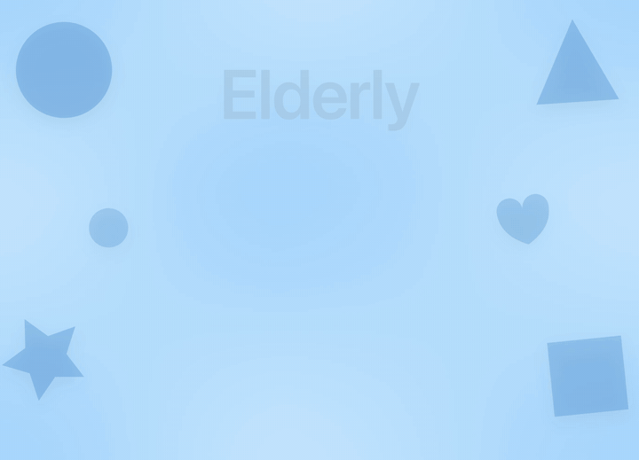

# Elderly

App SwiftUI per iPad pensata per le persone anziane nelle case di riposo. Contiene giochi di memoria e quiz con le foto, da fare insieme: tocchi grandi, testi grandi in italiano, nessun timer e nessuna sconfitta. La configurazione è per iPad in orizzontale.

## I giochi

**Giochi di memoria**
- **Suona le forme:** si ripete insieme la melodia suonata dalle forme.
- **Trova le coppie:** si girano due carte alla volta per trovare le foto uguali.
- **Cosa manca?:** si indovina quale foto è sparita.
- **Proverbi:** si completa il proverbio.

**Quiz con le foto**
- **Scegli la foto:** si trova la foto giusta tra quelle proposte.
- **Sì o no:** si risponde con un segno.

Chi accompagna il gioco può anche creare i propri quiz, con le foto, dalla sezione **Crea o modifica quiz**. Si gioca senza nome oppure in una o due persone salvate in **Utenti**.

## Aprire ed eseguire

1. Apri `Elderly.xcodeproj` con Xcode.
2. Seleziona lo schema **Elderly** e un simulatore iPad con iPadOS 26 o successivo.
3. Premi **Run** (⌘R).

Il progetto corrente richiede Xcode 27 o successivo con SDK compatibile. Per un dispositivo fisico, seleziona il tuo team Apple in **Signing & Capabilities**. Il bundle identifier è `Workspacess.Elderly`.

## Git e GitHub

Repository: https://github.com/rgiampo/Elderly

Aprendo il progetto, Xcode rileva il repository Git della cartella principale. Salva le modifiche con **Integrate → Commit** e caricale con **Integrate → Push** dopo aver configurato credenziali GitHub valide con accesso in scrittura.

Il repository esclude file temporanei, preferenze personali di Xcode, build e credenziali locali. Lo schema condiviso e i sorgenti sono versionati.
